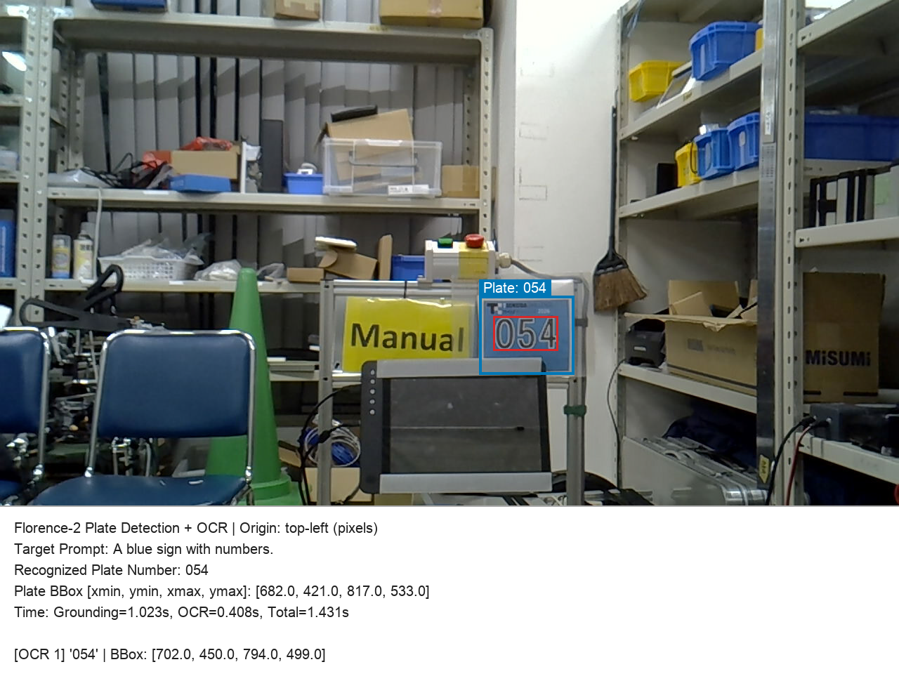
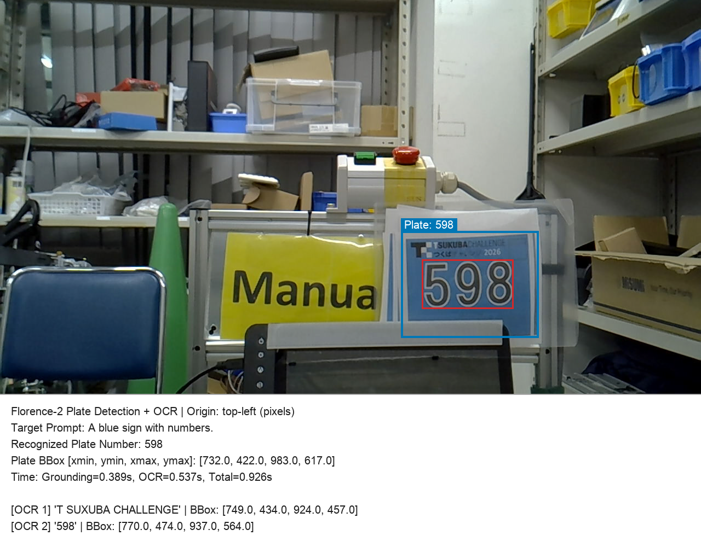
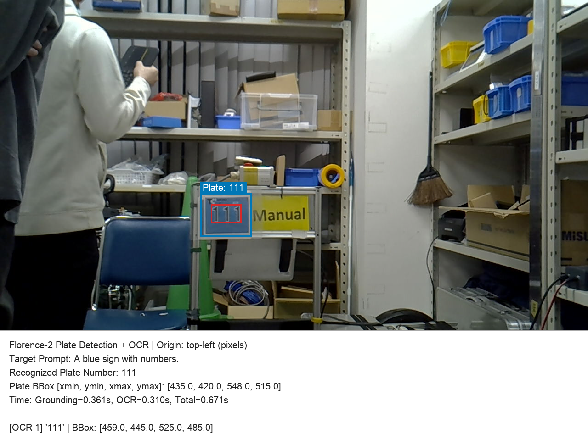

# number_plate_recognition

Florence-2 を用いた「つくばチャレンジ 2026」ロボットナンバープレート領域検出（Bounding Box 取得）および 3桁ナンバー OCR の検証リポジトリです。  
ベース実装は [Shuma-s58/florence2_work](https://github.com/Shuma-s58/florence2_work) を参考にしています。

```
入力画像 (1280×720)
  ├─[1. <CAPTION_TO_PHRASE_GROUNDING>]─▶ ナンバープレート領域 BBox 検出 ('A blue sign with numbers.')
  ├─[2. 切り出し + 白背景パディング]────▶ 768×768 リサイズ時の文字引き伸ばし歪みを防止 (3倍枠)
  └─[3. <OCR_WITH_REGION> + 3桁抽出]───▶ 3桁ナンバー文字列 ('054' 等、先頭0保持) + 結果画像 / JSON
```

---

## ディレクトリ構成

```text
number_plate_recognition/
├── florence2_plate_ocr.py        # 単一画像に対するプレート領域検出＋3桁ナンバーOCRスクリプト
├── evaluate_all.py               # number_plates/ 全30枚に対する精度・処理時間の一括評価スクリプト
├── requirements.txt              # Python 依存パッケージ一覧
├── number_plates/                # 検証用カメラ画像一式（10種類 × 3条件 = 計30枚）
├── robot-number-plate_2026.pdf   # ナンバープレート印刷元データ（正解ラベル10種類）
└── results/
    ├── evaluation_results.json   # 全30枚×2モデル（base / large）の評価結果データ
    └── samples/                  # 各撮影条件における認識結果の可視化サンプル画像
```

---

## セットアップ（追実験手順）

Python 3.9 以上（推奨: 3.10 以上）の仮想環境を作成し、依存パッケージをインストールします。

```bash
cd number_plate_recognition
python3 -m venv .venv
source .venv/bin/activate

# パッケージのインストール（CUDA環境の場合は必要に応じて PyTorch の index-url を指定）
python -m pip install -U pip
python -m pip install -r requirements.txt
```

初回実行時に Hugging Face からモデル重み（`florence-community/Florence-2-base` または `florence-community/Florence-2-large`）が自動ダウンロードされ、以降はキャッシュが再利用されます。  
ローカルの `models/Florence-2-base` 等に配置した場合はそちらを優先して読み込みます。

---

## 使い方

### 1. 単一画像の認識（`florence2_plate_ocr.py`）

```bash
# 既定モデル (Florence-2-large) で実行
python florence2_plate_ocr.py number_plates/1970-01-01-092301.jpg \
  -o output_054.png --json output_054.json

# 軽量・高速な Florence-2-base モデルを指定して実行
python florence2_plate_ocr.py number_plates/1970-01-01-092301.jpg \
  --model florence-community/Florence-2-base \
  -o output_054_base.png --json output_054_base.json
```

| 引数 | 説明 |
| :--- | :--- |
| `image`（位置引数） | 入力画像のパス |
| `-o`, `--output` | 出力するアノテーション PNG のパス（省略時は `<入力名>_plate_ocr.png`） |
| `--model` | モデル ID またはローカルディレクトリ（既定: `florence-community/Florence-2-large`） |
| `--text` | プレート領域検出用の英語プロンプト（既定: `'A blue sign with numbers.'`） |
| `--device` | `auto` / `cuda` / `mps` / `cpu`（既定: `auto`） |
| `--json` | 認識結果を JSON 形式で保存するパス |

### 2. 全30枚の一括評価（`evaluate_all.py`）

`number_plates/` 内の全30枚に対して `Florence-2-base` と `Florence-2-large` の両方で認識精度・処理時間を計測し、`results/evaluation_results.json` に出力します。

```bash
python evaluate_all.py

# 全30枚のアノテーション結果画像も保存する場合
python evaluate_all.py --save-images-dir results/annotated_images
```

---

## 評価結果（全30枚）

### 計測環境
- **ハードウェア**: Apple M3 Pro (36GB RAM) / macOS (`mps`, `torch.float16`)
- **テストデータ**: `number_plates/` 全30枚
  - 正解ナンバー10種: `054`, `069`, `097`, `111`, `239`, `334`, `598`, `666`, `784`, `893`
  - **条件1** (`092301`〜`092543`, 10枚): 中距離・`Manual` 右側配置
  - **条件2** (`092917`〜`093156`, 10枚): 近距離・`Manual` 右側配置
  - **条件3** (`093521`〜`093751`, 10枚): 中遠距離・`Manual` 左側配置

### モデル別 認識精度・処理時間

| モデル | 正解数 / 総数 | 認識精度 | 平均Grounding時間 | 平均OCR時間 | 平均合計時間 | 最小〜最大合計時間 |
| :--- | :---: | :---: | :---: | :---: | :---: | :---: |
| **`Florence-2-base`** | **30 / 30** | **100.0%** | **0.406 s** | **0.431 s** | **0.837 s** | 0.671 s 〜 1.431 s |
| **`Florence-2-large`** | **30 / 30** | **100.0%** | **0.900 s** | **1.017 s** | **1.917 s** | 1.695 s 〜 2.436 s |

### 元リポジトリ（`florence2_work`）無変更時との比較

| 手法・構成 | `Florence-2-base` | `Florence-2-large` | 備考 |
| :--- | :---: | :---: | :--- |
| ① `crop_labels_montage.py` + `florence2_ocr.py`（無変更） | 0 / 30 (0.0%) | 0 / 30 (0.0%) | 青地プレートのため白い紙抽出条件で不検出・背景壁誤検出 |
| ② `florence2_number.py` 単体（無変更） | 24 / 30 (80.0%) | 15 / 30 (50.0%) | プレート上部の `'2026'` 混入、および隣り合う `'054 Manual'` の結合により除外 |
| ③ Grounding検出＋切り出しOCR（余白パディングなし） | 23 / 30 (76.7%) | 27 / 30 (90.0%) | `768×768` リサイズ時の過度な拡大により `'111'` や `'666'` 等で認識失敗 |
| **④ 本実装（`florence2_plate_ocr.py`：パディング＋3桁抽出）** | **30 / 30 (100.0%)** | **30 / 30 (100.0%)** | **全条件・全画像で完全一致** |

---

## 認識結果サンプル（`Florence-2-base`）

### 条件1：中距離・右側配置（`1970-01-01-092301.jpg` / 正解: `054`）


### 条件2：近距離・右側配置（`1970-01-01-093101.jpg` / 正解: `598`）


### 条件3：中遠距離・左側配置（`1970-01-01-093616.jpg` / 正解: `111`）

